# Cord Themes

An open, curated list of themes for [Cord](https://github.com/cord-note/cord). 32 themes, each with a dark and a light version that follow your Light, Dark or System setting.

New themes are welcome. See [CONTRIBUTING.md](CONTRIBUTING.md).

## Install

In Cord, open **Settings → Appearance → Theme**, choose **Import → From Git repo…** and paste `https://github.com/cord-note/cord-themes`. Every theme appears in the gallery under **Library**.

To install only one theme, paste the link to its folder instead, shown under each theme below.

You can also download this repository as a zip and use **Import → From zip…**.

To update later, right-click a theme in the gallery and choose **Update from source**.

## Themes

- [Classic palettes](#classic-palettes): Catppuccin, Dracula, Everforest, Gruvbox, Kanagawa, Nord, Rosé Pine, Solarized, Tokyo Night
- [From photographs](#from-photographs): Koi, Kombu, Lotus, Maroon Oak, Meadow, Spiced Cocoa, Winter Woods
- [Colour combos](#colour-combos): Blush, Ember, Espresso, Evergreen, Harbour, Hazard, Ink, Lavender, Neon Red, Orchid, Steel, Sunset Drive, Terracotta, Tidepool, Trailhead, Ultraviolet

Tags: `blue`, `brown`, `calm`, `classic`, `clean`, `cool`, `cozy`, `dark`, `earthy`, `green`, `grey`, `high-contrast`, `japanese`, `monochrome`, `muted`, `neutral`, `orange`, `pastel`, `pink`, `professional`, `purple`, `red`, `retro`, `soft`, `teal`, `vivid`, `warm`, `yellow`

## Classic palettes

Hand-tuned versions of palettes many people already use in their code editor.

### Catppuccin

Soothing pastels: Mocha at night, Latte by day

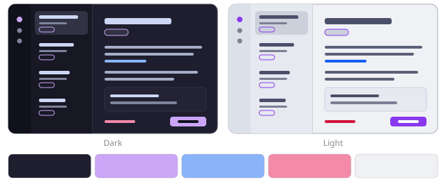

- Palette: [Catppuccin](https://github.com/catppuccin/catppuccin)
- Tags: `purple`, `pastel`, `cool`
- Install only this one: `https://github.com/cord-note/cord-themes/tree/main/themes/catppuccin`

### Dracula

Dark purple vampire chic, with Alucard for daylight

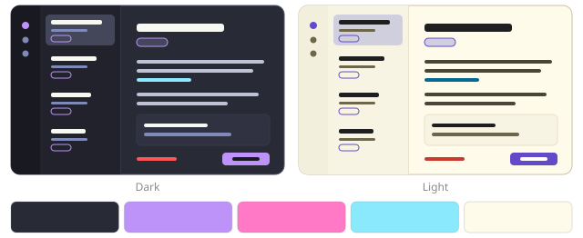

- Palette: [Dracula by Zeno Rocha](https://draculatheme.com)
- Tags: `purple`, `dark`, `vivid`
- Install only this one: `https://github.com/cord-note/cord-themes/tree/main/themes/dracula`

### Everforest

Green, warm and easy on the eyes

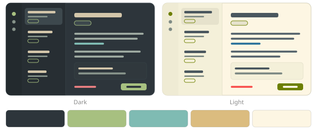

- Palette: [Everforest by sainnhe](https://github.com/sainnhe/everforest)
- Tags: `green`, `warm`, `soft`
- Install only this one: `https://github.com/cord-note/cord-themes/tree/main/themes/everforest`

### Gruvbox

Retro groove: warm browns, yellow and orange

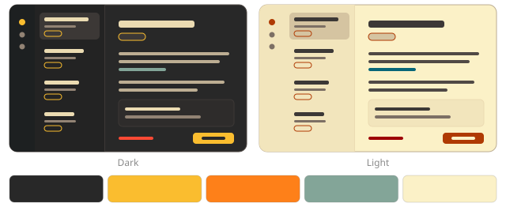

- Palette: [Gruvbox by Pavel Pertsev](https://github.com/morhetz/gruvbox)
- Tags: `warm`, `retro`, `yellow`
- Install only this one: `https://github.com/cord-note/cord-themes/tree/main/themes/gruvbox`

### Kanagawa

Inspired by The Great Wave: ink, wave blue and lotus paper

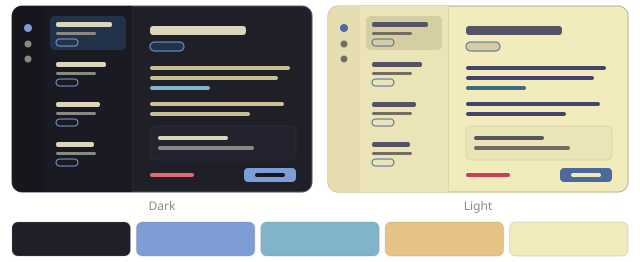

- Palette: [Kanagawa by rebelot](https://github.com/rebelot/kanagawa.nvim)
- Tags: `blue`, `muted`, `japanese`
- Install only this one: `https://github.com/cord-note/cord-themes/tree/main/themes/kanagawa`

### Nord

Arctic, north-bluish calm

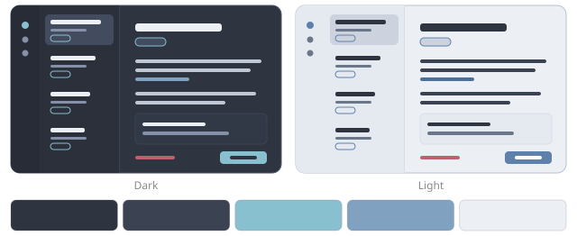

- Palette: [Nord by Arctic Ice Studio](https://www.nordtheme.com)
- Tags: `blue`, `cool`, `muted`
- Install only this one: `https://github.com/cord-note/cord-themes/tree/main/themes/nord`

### Rosé Pine

All natural pine, faux fur and a bit of soho vibes

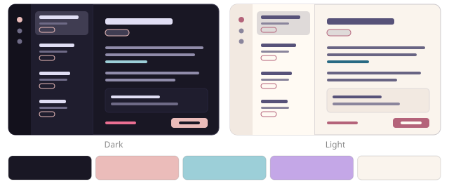

- Palette: [Rosé Pine](https://rosepinetheme.com)
- Tags: `pink`, `muted`, `soft`
- Install only this one: `https://github.com/cord-note/cord-themes/tree/main/themes/rose-pine`

### Solarized

The precision palette, in both its famous halves

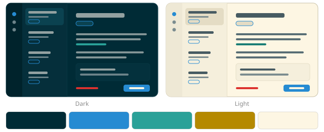

- Palette: [Solarized by Ethan Schoonover](https://ethanschoonover.com/solarized/)
- Tags: `blue`, `teal`, `classic`
- Install only this one: `https://github.com/cord-note/cord-themes/tree/main/themes/solarized`

### Tokyo Night

Neon city lights after dark, clean paper by day

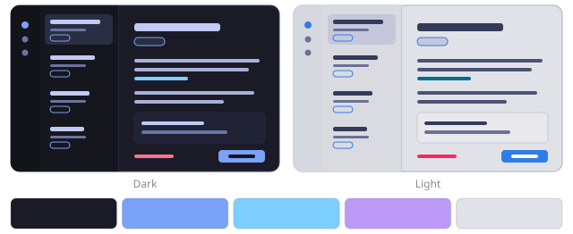

- Palette: [Tokyo Night by enkia](https://github.com/enkia/tokyo-night-vscode-theme)
- Tags: `blue`, `purple`, `cool`
- Install only this one: `https://github.com/cord-note/cord-themes/tree/main/themes/tokyo-night`

## From photographs

Palettes pulled from photographs: snow, sea, meadows, ponds and flowers.

### Koi

Black water, grey stone and orange koi

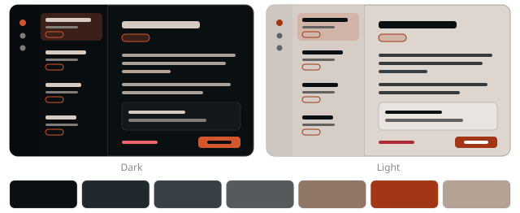

- Palette: palettepoint.com
- Tags: `dark`, `orange`, `grey`, `high-contrast`
- Install only this one: `https://github.com/cord-note/cord-themes/tree/main/themes/koi`

### Kombu

Seaweed, sea foam and warm sand

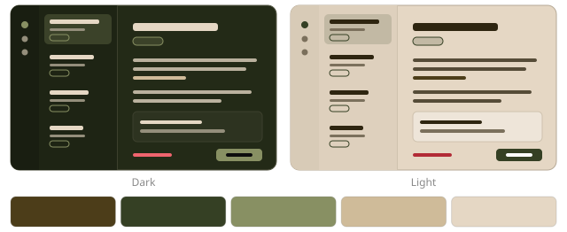

- Palette: seaside palette
- Tags: `green`, `earthy`, `warm`, `muted`
- Install only this one: `https://github.com/cord-note/cord-themes/tree/main/themes/kombu`

### Lotus

Lily pads, pink lotus flowers and deep water

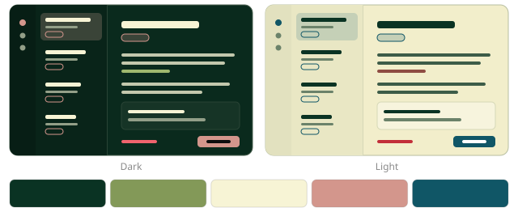

- Palette: lotus pond palette
- Tags: `green`, `pink`, `cool`, `pastel`
- Install only this one: `https://github.com/cord-note/cord-themes/tree/main/themes/lotus`

### Maroon Oak

Dark orchids, oxblood leather and linen

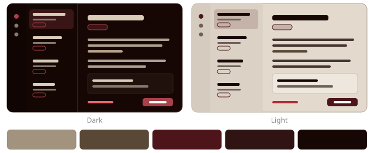

- Palette: Engie Designs
- Tags: `red`, `brown`, `warm`, `dark`
- Install only this one: `https://github.com/cord-note/cord-themes/tree/main/themes/maroon-oak`

### Meadow

Green hills, wheat, a slate sky and one bright red

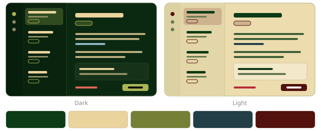

- Palette: Casa Chromatica
- Tags: `green`, `earthy`, `vivid`
- Install only this one: `https://github.com/cord-note/cord-themes/tree/main/themes/meadow`

### Spiced Cocoa

Snowy morning, hot chocolate and a red car under the pines

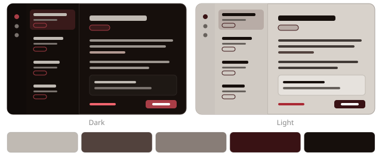

- Palette: Engie Designs
- Tags: `warm`, `brown`, `red`, `muted`
- Install only this one: `https://github.com/cord-note/cord-themes/tree/main/themes/spiced-cocoa`

### Winter Woods

Snow-covered pines under a starry night sky

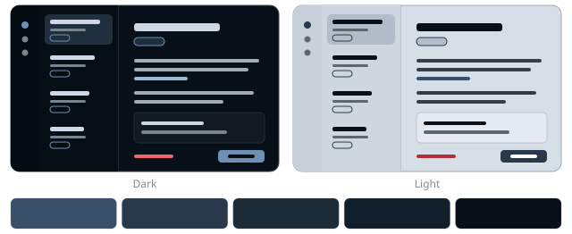

- Palette: Winter Woods, shadesurfer.io
- Tags: `blue`, `cool`, `dark`, `muted`
- Install only this one: `https://github.com/cord-note/cord-themes/tree/main/themes/winter-woods`

## Colour combos

Simple two-colour combinations that always work, each grown into a full theme.

### Blush

Pink and grey: soft, modern, aesthetic

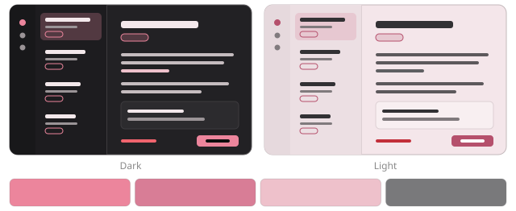

- Palette: Colour Combos: Pink & Grey
- Tags: `pink`, `pastel`, `soft`
- Install only this one: `https://github.com/cord-note/cord-themes/tree/main/themes/blush`

### Ember

Orange and brown: warm, rich, earthy

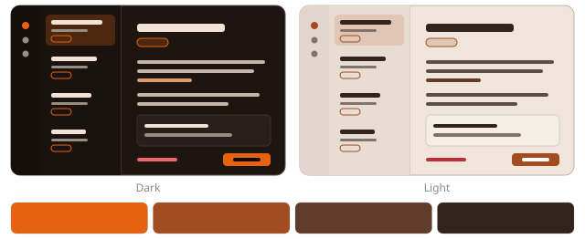

- Palette: Colour Combos: Orange & Brown
- Tags: `orange`, `brown`, `warm`
- Install only this one: `https://github.com/cord-note/cord-themes/tree/main/themes/ember`

### Espresso

Brown and cream: cozy, classy, vintage

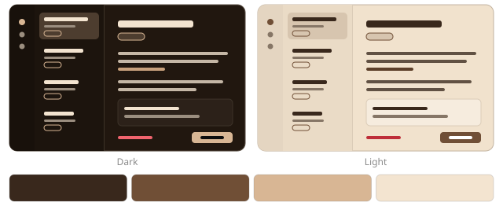

- Palette: Colour Combos: Brown & Cream
- Tags: `brown`, `warm`, `cozy`
- Install only this one: `https://github.com/cord-note/cord-themes/tree/main/themes/espresso`

### Evergreen

Green and black: fresh, calm, premium

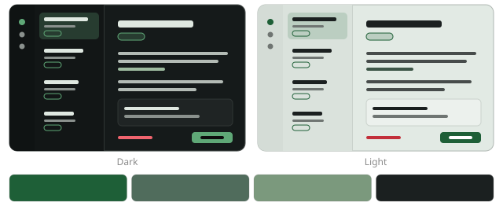

- Palette: Colour Combos: Green & Black
- Tags: `green`, `dark`, `calm`
- Install only this one: `https://github.com/cord-note/cord-themes/tree/main/themes/evergreen`

### Harbour

Navy and white: calm, fresh, timeless

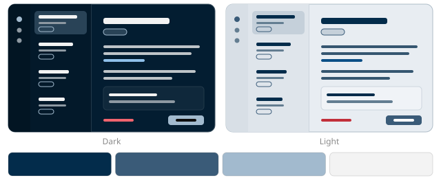

- Palette: Colour Combos: Navy & White
- Tags: `blue`, `cool`, `clean`
- Install only this one: `https://github.com/cord-note/cord-themes/tree/main/themes/harbour`

### Hazard

Yellow and black: energetic, sharp, bold

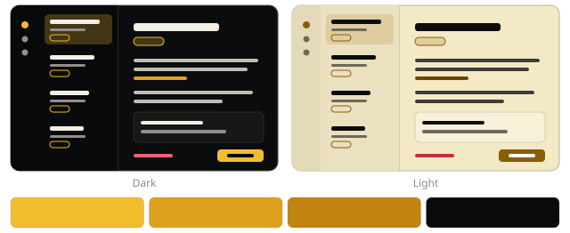

- Palette: Colour Combos: Yellow & Black
- Tags: `yellow`, `dark`, `high-contrast`
- Install only this one: `https://github.com/cord-note/cord-themes/tree/main/themes/hazard`

### Ink

Black and white: classic, clean, always works

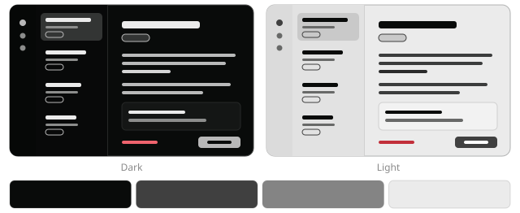

- Palette: Colour Combos: Black & White
- Tags: `monochrome`, `neutral`, `high-contrast`
- Install only this one: `https://github.com/cord-note/cord-themes/tree/main/themes/ink`

### Lavender

Lavender and white: soft, dreamy, peaceful

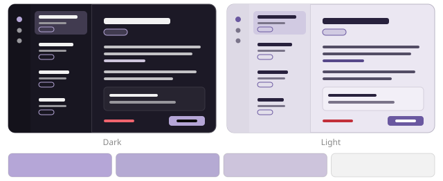

- Palette: Colour Combos: Lavender & White
- Tags: `purple`, `pastel`, `soft`
- Install only this one: `https://github.com/cord-note/cord-themes/tree/main/themes/lavender`

### Neon Red

Black and red: bold, edgy, confident

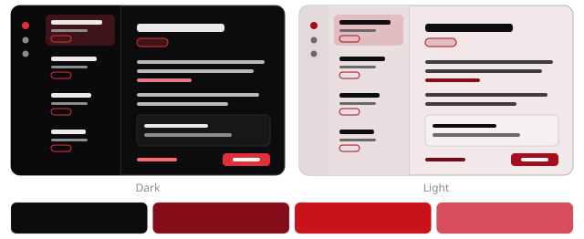

- Palette: Colour Combos: Black & Red
- Tags: `red`, `dark`, `vivid`
- Install only this one: `https://github.com/cord-note/cord-themes/tree/main/themes/neon-red`

### Orchid

Monochrome in one hue: simple, clean, stylish

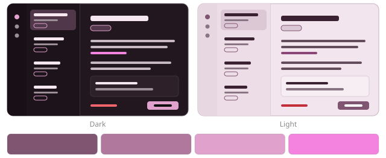

- Palette: Colour Combos: Monochrome (any hue)
- Tags: `pink`, `purple`, `monochrome`
- Install only this one: `https://github.com/cord-note/cord-themes/tree/main/themes/orchid`

### Steel

Blue and grey: cool, sleek, professional

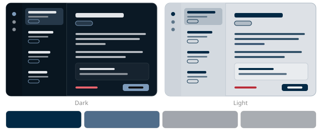

- Palette: Colour Combos: Blue & Grey
- Tags: `blue`, `grey`, `cool`, `professional`
- Install only this one: `https://github.com/cord-note/cord-themes/tree/main/themes/steel`

### Sunset Drive

Blue and orange: energetic, vibrant, fun

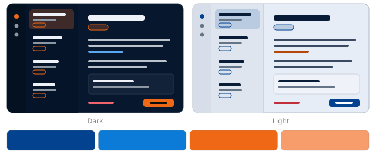

- Palette: Colour Combos: Blue & Orange
- Tags: `blue`, `orange`, `vivid`
- Install only this one: `https://github.com/cord-note/cord-themes/tree/main/themes/sunset-drive`

### Terracotta

Red and beige: warm, classy, striking

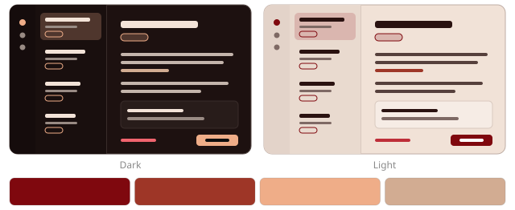

- Palette: Colour Combos: Red & Beige
- Tags: `red`, `warm`, `earthy`
- Install only this one: `https://github.com/cord-note/cord-themes/tree/main/themes/terracotta`

### Tidepool

Teal and beige: chill, balanced, modern

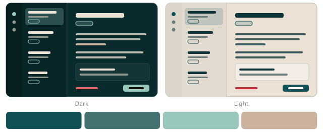

- Palette: Colour Combos: Teal & Beige
- Tags: `teal`, `cool`, `calm`
- Install only this one: `https://github.com/cord-note/cord-themes/tree/main/themes/tidepool`

### Trailhead

Earth tones: warm, natural, relaxed

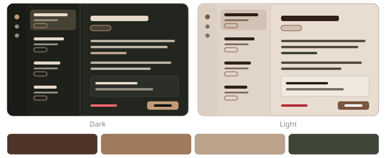

- Palette: Colour Combos: Earth Tones
- Tags: `earthy`, `brown`, `green`, `warm`
- Install only this one: `https://github.com/cord-note/cord-themes/tree/main/themes/trailhead`

### Ultraviolet

Purple and black: mysterious, stylish, creative

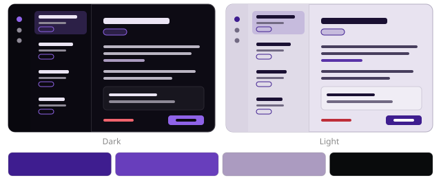

- Palette: Colour Combos: Purple & Black
- Tags: `purple`, `dark`, `vivid`
- Install only this one: `https://github.com/cord-note/cord-themes/tree/main/themes/ultraviolet`

## Credits

Colour palettes belong to their authors and are credited under each theme. Where a palette had no colour dark or light enough for a background, a deeper or paler shade of its own colours is used, and text colours are adjusted until they meet WCAG contrast (4.5:1 for text and links). The theme files in this repository are MIT licensed.
